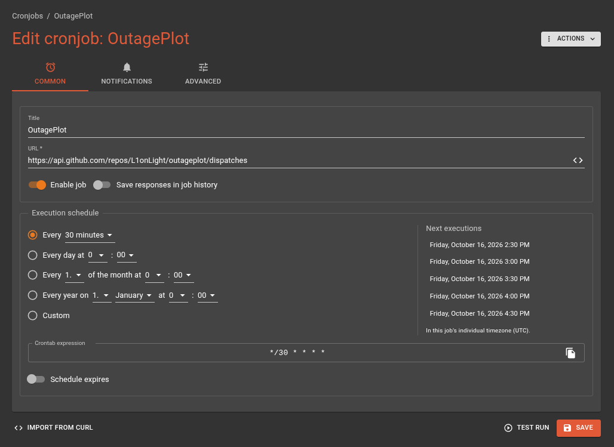
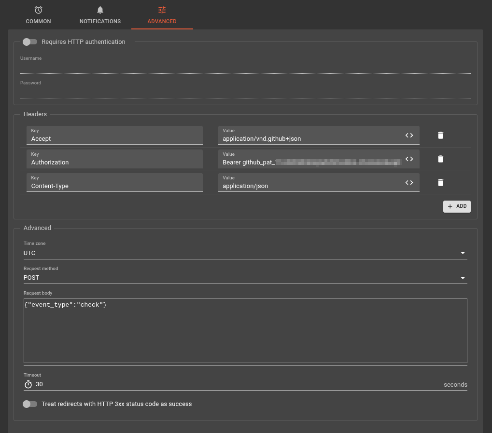

# Швидке налаштування

Як запустити власного бота для своєї адреси без сервера: GitHub Actions + [cron-job.org](https://cron-job.org/).
Займе ~15 хвилин. Потрібні лише акаунти GitHub, Telegram і cron-job.org.

> Працює лише для адрес [ДТЕК Київські електромережі](https://www.dtek-kem.com.ua/ua/shutdowns).

## 1. Telegram-бот і чат

1. Напишіть [@BotFather](https://t.me/BotFather) → `/newbot` → збережіть токен (`123456789:AA...`).
   Це `TELEGRAM_BOT_TOKEN`.
2. Створіть канал (або групу) і додайте бота **адміністратором** з правами
   публікувати, редагувати й видаляти повідомлення.
3. Дізнайтеся ID чату: опублікуйте в каналі будь-яке повідомлення й відкрийте в браузері
   `https://api.telegram.org/bot<TOKEN>/getUpdates`. Знайдіть `"chat":{"id":-100...}` —
   це `TELEGRAM_CHAT_ID` (разом з мінусом).
   Для публічного каналу можна вказати й `@назва_каналу`.

## 2. Fork репозиторію

1. Відкрийте [github.com/L1onLight/outageplot](https://github.com/L1onLight/outageplot) → **Fork**.
   Залиште позначку **Copy the `main` branch only**: інакше у форк потрапить гілка `artifacts`
   зі станом оригінального бота. Натисніть **Create fork**.
2. У своєму форку перейдіть на вкладку **Actions** і натисніть
   **I understand my workflows, go ahead and enable them** — у форках workflow вимкнені за замовчуванням.

## 3. Secrets

Секрети не копіюються під час форку, їх треба задати у **своєму** репозиторії:
**Settings → Secrets and variables → Actions → New repository secret**.

| Назва | Приклад | Опис |
|---|---|---|
| `TELEGRAM_BOT_TOKEN` | `123456789:AA...` | Токен від BotFather |
| `TELEGRAM_CHAT_ID` | `-1001234567890` | ID каналу чи групи |
| `STREET` | `вул. Хрещатик` | Вулиця **точно як на сайті ДТЕК** (з `вул.`, `просп.` тощо) |
| `HOUSE` | `10/к.1` | Номер будинку точно як на сайті ДТЕК |

Щоб перевірити написання, введіть адресу на [сайті ДТЕК](https://www.dtek-kem.com.ua/ua/shutdowns)
і скопіюйте значення з підказок. Якщо будинок не знайдеться, бот у лозі workflow виведе список
доступних номерів на вулиці.

<details>
<summary>Альтернатива: задати секрети з локального <code>.env</code> через <code>gh</code></summary>

```sh
git clone https://github.com/<you>/outageplot && cd outageplot
cp .env.example .env   # заповніть значення
gh repo set-default <you>/outageplot   # інакше gh може взяти оригінальний репозиторій
./scripts/setup_gh_secrets.py
```
</details>

## 4. Перший запуск

**Actions → svitlobot → Run workflow**, увімкніть `force` → **Run workflow**.
За 1–2 хвилини в чаті має зʼявитися картинка з графіком (приклад — [images/plot_example.png](images/plot_example.png)).
Якщо ні — відкрийте лог запуску.

Вже зараз бот запускатиметься раз на годину вбудованим cron GitHub. Але він часто запізнюється
чи пропускає запуски, тому для регулярних перевірок кожні 30 хв потрібен зовнішній cron.

## 5. Токен GitHub для cron

**GitHub → Settings → Developer settings → Personal access tokens → Fine-grained tokens →
[Generate new token](https://github.com/settings/personal-access-tokens/new)**:

- **Repository access:** Only select repositories → ваш форк `outageplot`;
- **Permissions → Repository permissions → Contents:** Read and write;
- **Expiration:** на ваш розсуд. Коли термін вийде, cron почне отримувати `401` —
  згенеруйте новий токен і замініть його в cron-job.org.

Скопіюйте токен (`github_pat_...`), він показується лише один раз.

## 6. cron-job.org

[Console](https://console.cron-job.org/) → **Create cronjob**.

Вкладка **Common**:
- **URL:** `https://api.github.com/repos/<you>/outageplot/dispatches`
  (`<you>` — ваш логін на GitHub, **не** `L1onLight`);
- **Execution schedule:** Every 30 minutes.



Вкладка **Advanced**:
- **Request method:** `POST`;
- **Headers:**

  | Key | Value |
  |---|---|
  | `Authorization` | `Bearer github_pat_...` |
  | `Accept` | `application/vnd.github+json` |
  | `Content-Type` | `application/json` |

- **Request body:** `{"event_type": "check"}`



Натисніть **Test run**: відповідь має бути `204 No Content`, а у вкладці **Actions** форку
зʼявиться новий запуск. Збережіть cronjob.

| Відповідь | Причина |
|---|---|
| `204` | Все добре |
| `401` | Неправильний або прострочений токен |
| `403` / `404` | Токен не має доступу до цього репозиторію чи права Contents, або помилка в URL |
| `422` | Немає `{"event_type": "check"}` у тілі запиту |

## Готово

Що робить бот далі:
- раз на добу надсилає нове повідомлення з графіком, а протягом дня лише редагує його;
- окремо повідомляє про позапланові відключення;
- уночі (23:00–08:00) надсилає повідомлення без звуку.

Деталі — у [README](README.md).

Стан бота зберігається в гілці `artifacts` вашого форку. Не видаляйте її, інакше бот
вважатиме наступний запуск першим і надішле нове повідомлення.
